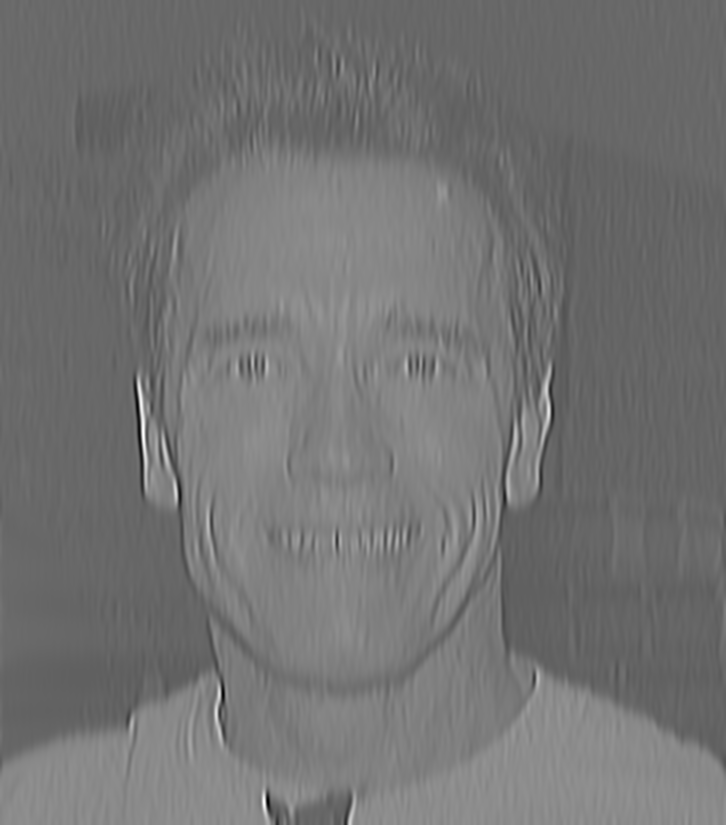
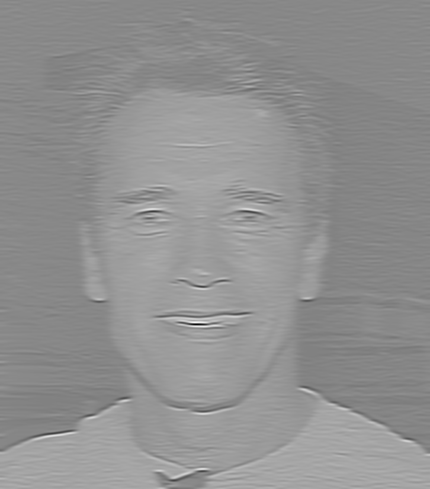
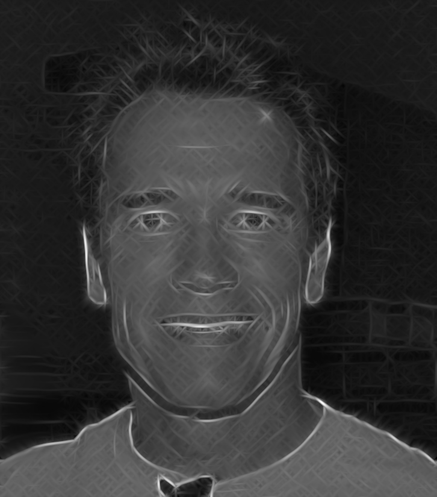
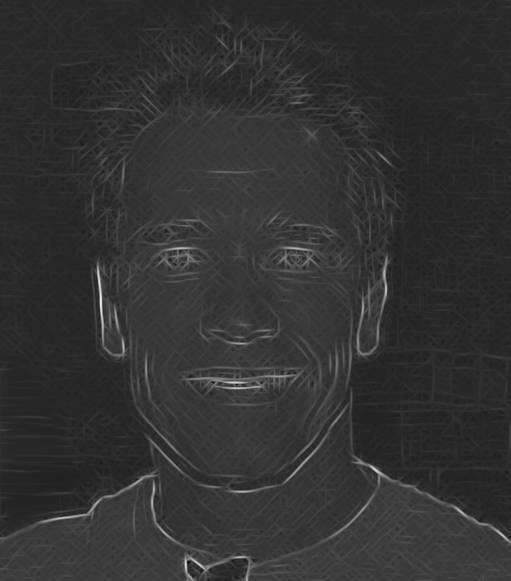
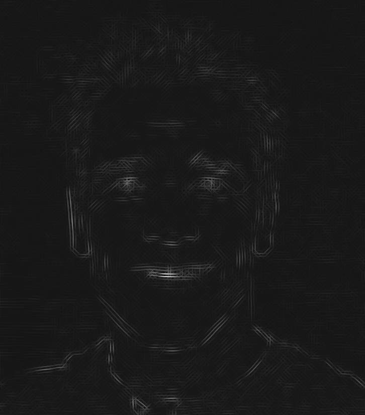

#+OPTIONS toc:nil

* Perspective rectification
** perspective transform

#+begin_src c
    Point2f src[4] = {
        {647, 571},
        {2515, 565},
        {3019, 3401},
        {132, 3396}
    };

    Point2f dst[4] = {
        {0, 0},
        {210, 0},
        {210, 297},
        {0, 297}
    };
    
    warpPerspective(image, image2, getPerspectiveTransform(src, dst), Size(210,297));
#+end_src

** affine transform

#+begin_src c
    Point2f affine_src[3] = {
        {647, 571},
        {2515, 565},
        {132, 3396}
    };

    Point2f affine_dst[3] = {
        {0,0},
        {(float)image.cols, 0},
        {0, (float)image.rows}
    };

    Mat affine_matrix = getAffineTransform(affine_src, affine_dst);
    warpAffine(image, image2, affine_matrix, image.size());

    //manual application of affine transformation matrix to point
    Point2f original_point(3019, 3401);

    Point2f transformed_point;

    transformed_point.x =
        affine_matrix.at<double>(0, 0) * original_point.x +
        affine_matrix.at<double>(0, 1) * original_point.y +
        affine_matrix.at<double>(0, 2);

    transformed_point.y =
        affine_matrix.at<double>(1, 0) * original_point.x +
        affine_matrix.at<double>(1, 1) * original_point.y +
        affine_matrix.at<double>(1, 2);
#+end_src 

The fourth corner ends up at (4752, 4100) instead of around (3019, 3401), distance 1868.66

** explanation
An affine transformation preserves lines and parallelism. If the original image has non-parallel lines (like the vertical lines on our sheet of paper) they will not be parallel after the transformation. In comparison, te 

* Gausssian and Laplacian pyramid
** gabor kernels
#+begin_src c
  const double sigma = 4.0, lambda = 10.0, gamma = 0.5, psi = 0;
  const int angles[4] = {0, 45, 90, 135};

  for (int i = 0; i < 4; ++i) {
    double theta = angles[i] * CV_PI / 180.0;
    
    // compute kernel
    Mat kernel = getGaborKernel(Size(31, 31), sigma, theta, lambda, gamma, psi, CV_32F);
    
    // filter image
    Mat resp;
    filter2D(img, resp, CV_32F, kernel);

    // combine results by taking the max value of each pixel
    max(combined, resp, combined);
  }

#+end_src

*** 0 degrees:
#+ATTR_LATEX: :width 0.5\textwidth
  
#+ATTR_LATEX: :width 0.5\textwidth
  

*** 45 degrees:
#+ATTR_LATEX: :width 0.5\textwidth

#+ATTR_LATEX: :width 0.5\textwidth

*** 90 degrees:
#+ATTR_LATEX: :width 0.5\textwidth

#+ATTR_LATEX: :width 0.5\textwidth

*** 135 degrees:
#+ATTR_LATEX: :width 0.5\textwidth

#+ATTR_LATEX: :width 0.5\textwidth

*** result
#+ATTR_LATEX: :width 0.5\textwidth

** playing with parameters
i use 
#+begin_src c
  const int ksize = 6*sigma+1
#+end_src

*** lambda=15
#+ATTR_LATEX: :width 0.5\textwidth

*** lambda=12
#+ATTR_LATEX: :width 0.5\textwidth

*** lambda=8
#+ATTR_LATEX: :width 0.5\textwidth

*** lambda=5
#+ATTR_LATEX: :width 0.5\textwidth

For faces a lambda of around 8 seems best.
